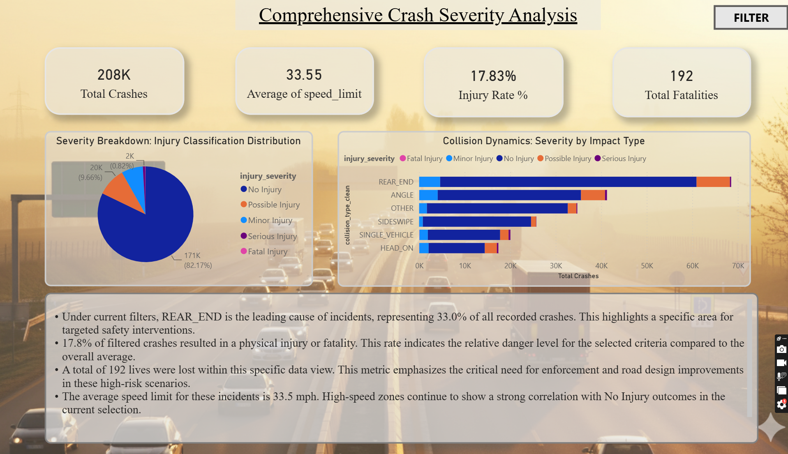

# Vehicle Crash Injury Prediction

A machine learning project that predicts whether a vehicle crash will result in an injury, using 210,399 crash records. It covers the full workflow: PostgreSQL data extraction, cleaning, feature engineering, model training, a Flask prediction API, a React frontend and a Power BI dashboard.

**Live demo:** https://crashguardai.netlify.app/

## Results

- Trained on 210,399 crash records with 61 engineered predictors
- Random Forest classifier with 81% recall on injury cases, using a tuned decision threshold of 0.48
- SHAP used to show which factors raise or lower injury risk for each prediction

## Demo

- [Full project demo (model + web app)](https://youtu.be/a0pc44KEHp0)
- [Power BI dashboard walkthrough](https://youtu.be/t2-qywa1io8)

## How it works

```text
PostgreSQL -> cleaning -> feature engineering -> Random Forest -> saved model (.pkl) -> Flask API -> React app / Power BI
```

- **Cleaning:** removes noisy and leaky columns, standardizes categorical and numeric fields, and writes a clean table back to PostgreSQL.
- **Feature engineering:** category consolidation, binary flags and numeric binning, built as reusable scikit-learn transformers.
- **Model:** Random Forest (400 trees, max depth 12, balanced class weights), with the decision threshold tuned for injury recall rather than accuracy.
- **Explainability:** SHAP values show each feature's contribution to a prediction.
- **Dashboard:** Power BI pages cover an executive summary, crash timing, environmental conditions, driver and vehicle analysis, geographic heatmaps and injury prediction insights.

## Tech stack

Python, Pandas, Scikit-learn, SHAP, Flask, SQLAlchemy, PostgreSQL, React, Power BI

## Getting started

**1. Set up the environment**

```bash
git clone <repository-url>
cd crashreport
python -m venv venv
source venv/bin/activate        # Windows: venv\Scripts\activate
pip install -r requirements.txt
```

**2. Add the dataset**

The raw CSV is too large for GitHub, so [download it from Google Drive](https://drive.google.com/file/d/1pRww1svVeVpW0KagA2gEzeUgJnztQv7R/view?usp=drive_link) and save it as `data/raw/Crash_Reporting_-_Drivers_Data.csv`.

**3. Create the database and configure it**

```sql
CREATE DATABASE crash_report_db;
```

Import the CSV into a `crash_reports` table (pgAdmin or `COPY`), then create a `.env` file in the project root:

```env
DB_HOST=localhost
DB_PORT=5432
DB_NAME=crash_report_db
DB_USER=postgres
DB_PASSWORD=your_password
```

**4. Run the pipeline**

```bash
python crash_report/pipeline/load.py      # cleans data into crash_reports_analysis_clean
python crash_report/modeling/train.py     # trains the model, saves it to models/
python crash_report/modeling/predict.py   # sample prediction
```

**5. Start the API**

```bash
cd backend
python wsgi.py                            # runs on http://localhost:8000
```

Run the tests with `pytest`.

> The training pipeline reads from PostgreSQL, not directly from the CSV.

## Project structure

```text
crash_report/   data pipeline, feature engineering, training and prediction code
backend/        Flask API and saved model files
data/           raw, interim and processed data
notebooks/      exploration and analysis
tests/          pytest tests
```
## Key insights from the dashboard

- **Rear-end collisions are the leading crash type,** at 33.0% of all crashes.
- **17.8% of crashes involved an injury or fatality,** including 192 fatalities.
- **Crashes peak at 17:00 during the evening rush,** and Friday is the most frequent day.
- **Weekends account for 22.9% of crashes,** and Sunday has the highest injury rate.
- **90.8% of crashes happen in unincorporated areas.** Within city limits, Rockville, Gaithersburg and Takoma Park have the highest concentration.
- **Local roads are the most common location,** at 49% of crashes.




## License

MIT
